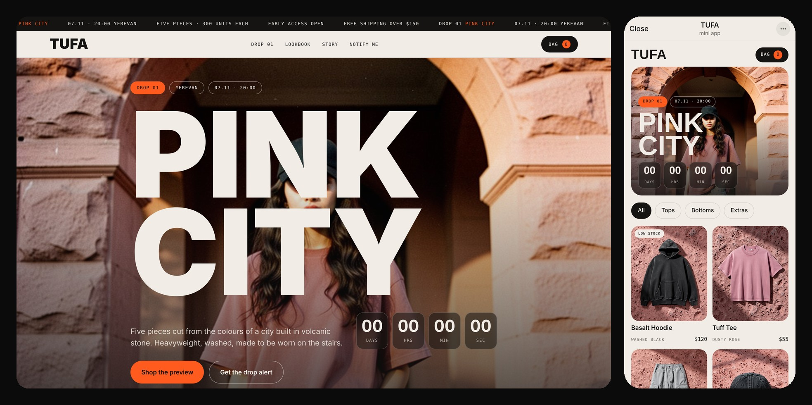
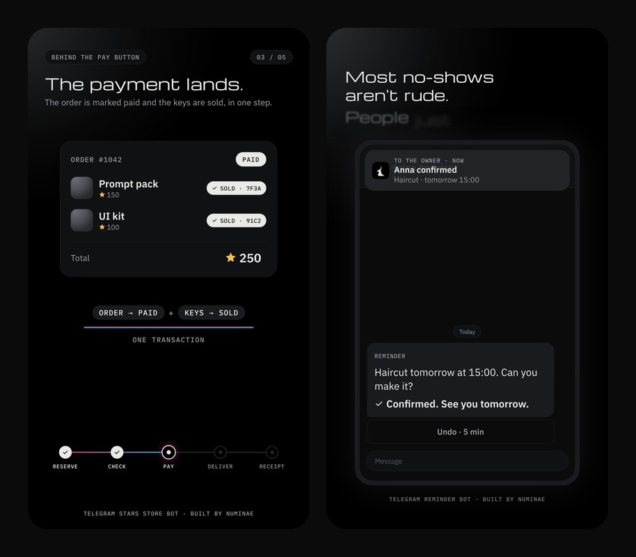
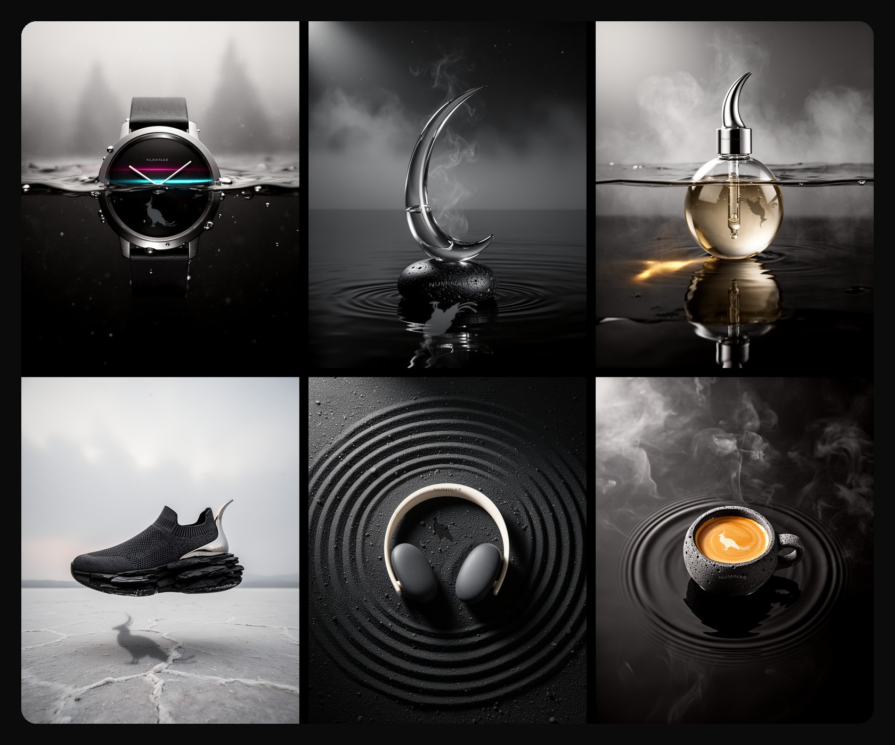
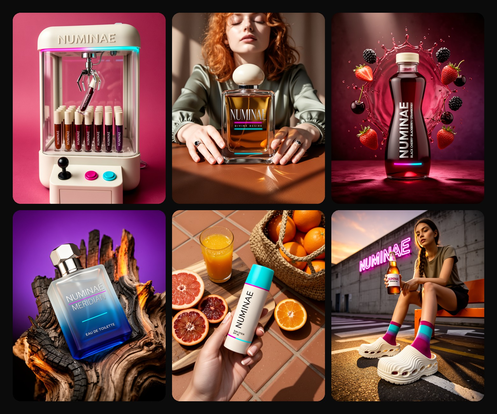
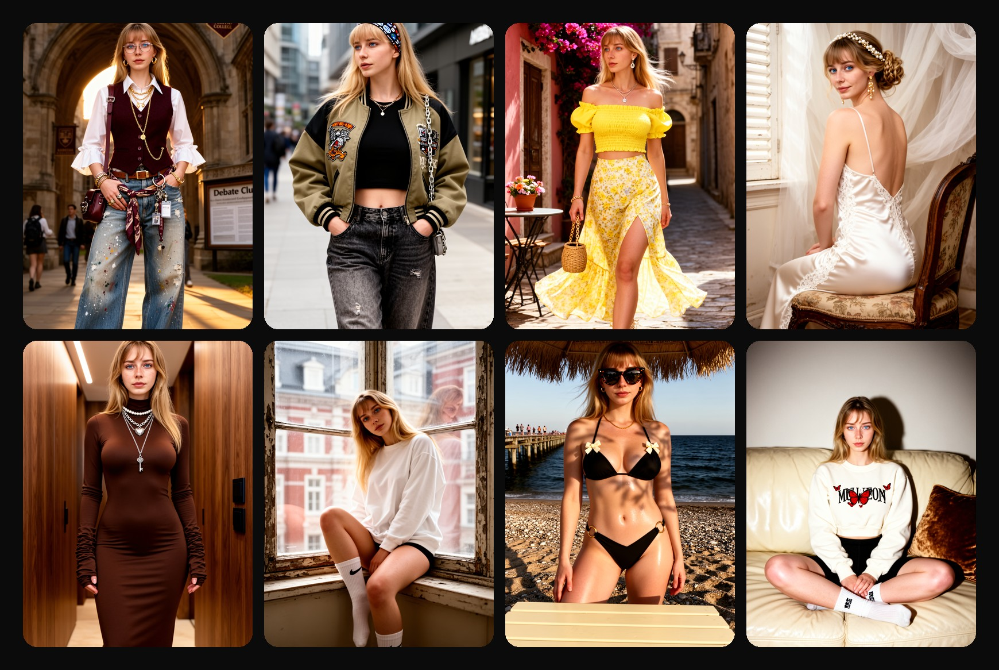
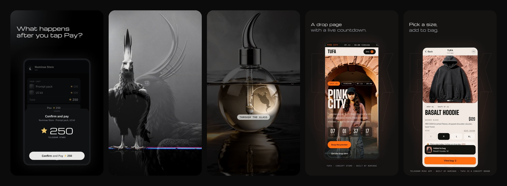

  <picture>
    <source media="(prefers-color-scheme: dark)" srcset="assets/numinae-dark.svg">
    
  </picture>

  Telegram bots, Mini Apps, websites, motion graphics, app design and characters. 
  One-person studio. Everything in writing, no calls needed.

  
  
  
  

---

## What I make

| | |
|---|---|
| 🤖 **Telegram bots** | Stores, payments in Telegram Stars, bookings and reminders |
| 📱 **Telegram Mini Apps** | A whole store or tool that opens inside a chat |
| 🛍 **E-commerce and custom websites** | Product pages, drops, carts that work |
| 🚀 **Landing pages** | One page, one job, fast on a phone |
| 🎬 **Motion graphics** | Product and brand reels, edited in code |
| 📐 **Mobile app design** | Screens and flows, ready to build |
| 🧍 **Characters** | Realistic, 3D and illustrated, the same face in every scene |

## Selected work

### TUFA · a streetwear drop, from zero

A made-up Yerevan label with its whole launch: brand, product shots, lookbook, a drop page with a live countdown, sizes and a working bag, and the same store rebuilt as a Telegram Mini App.

**[Drop page](https://numinae.github.io/tufa-drop/)** · **[Mini App demo](https://numinae.github.io/tufa-drop/miniapp/)** · [Code](https://github.com/NUMINAE/tufa-drop)

### Telegram bots

- **[Numinae Store](https://github.com/NUMINAE/numinae-store-bot)**: a store for digital goods paid with Telegram Stars. Cart, invoices, automatic delivery, refunds for late payments, and an owner panel.
- **[Salon Reminder Bot](https://github.com/NUMINAE/salon-reminder-bot)**: books appointments with buttons and reminds each client 24 hours ahead, with one-tap Confirm or Cancel.

### Product visuals

Six products I designed, each with the same bird hidden somewhere in the shot.

One brand, six product ads, every label rendered in the image.

### Characters

One character, many scenes, the same face every time.

### Motion

Reels for the work above, cut to the beat in code. Watch them on [Telegram](https://t.me/bynuminae) and [Instagram](https://instagram.com/numinae.studio).

---

  Tell me what you sell or what you need: <a href="https://t.me/numinaestudio"><b>@numinaestudio</b></a> on Telegram. 
  Everything in writing, no calls needed.

